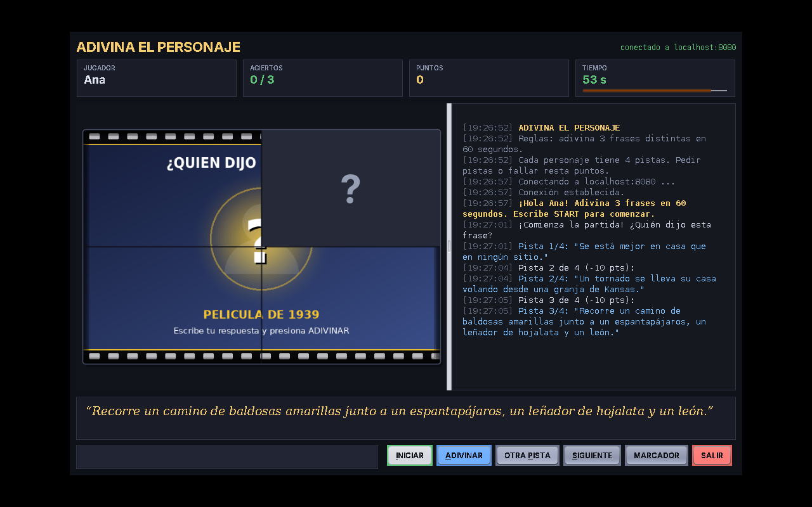
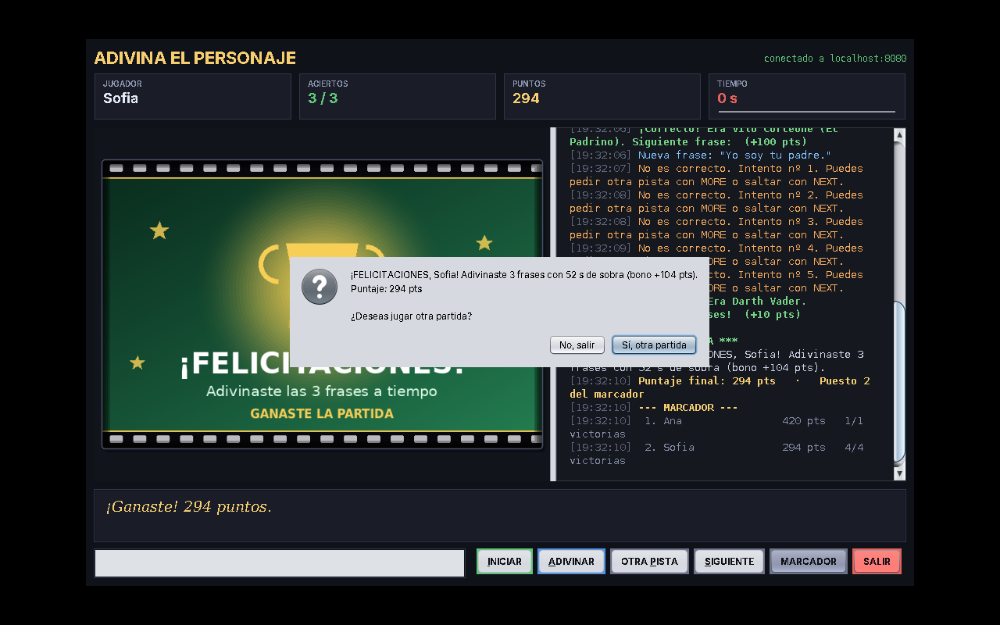
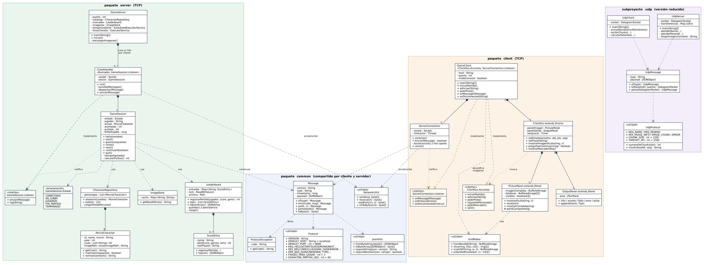
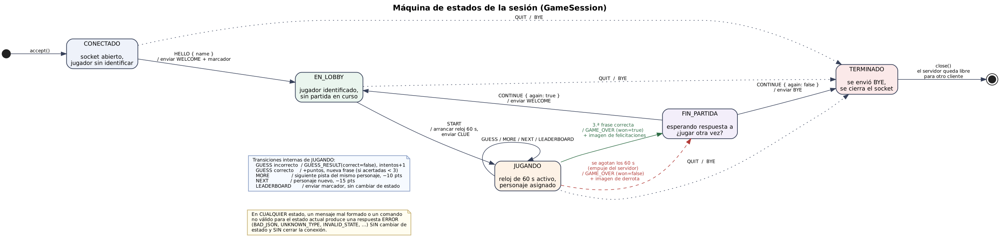

# Adivina el Personaje — Juego Cliente/Servidor con TCP, UDP y protocolo JSON

**Materia:** Principios de Sistemas de Software Distribuidos
**Evaluación:** Unidades 2 y 3 — Caso práctico
**Lenguaje:** Java 11+ · **Build:** Gradle · **Dependencia externa:** `org.json`

---

## Tabla de contenido

1. [Descripción general](#1-descripción-general)
2. [Checklist de requisitos cumplidos](#2-checklist-de-requisitos-cumplidos)
3. [Estructura del proyecto](#3-estructura-del-proyecto)
4. [Cómo compilar y ejecutar](#4-cómo-compilar-y-ejecutar)
5. [Diagramas UML](#5-diagramas-uml)
6. [Protocolo JSON (versión TCP)](#6-protocolo-json-versión-tcp)
7. [Protocolo JSON (versión UDP)](#7-protocolo-json-versión-udp)
8. [Sistema de puntos y marcador](#8-sistema-de-puntos-y-marcador)
9. [Decisiones de diseño](#9-decisiones-de-diseño)
10. [Robustez y manejo de errores](#10-robustez-y-manejo-de-errores)
11. [Ejecución en un servidor remoto (AWS / VM)](#11-ejecución-en-un-servidor-remoto-aws--vm)
12. [Guion sugerido para el video](#12-guion-sugerido-para-el-video)
13. [Resolución de problemas](#13-resolución-de-problemas)

---

## 1. Descripción general

### El juego

**Adivina el Personaje** es un juego cliente/servidor en el que el servidor muestra
la frase de un personaje de cine y el jugador tiene que adivinar **quién la dijo**.

- El servidor mantiene un catálogo de **8 personajes**; cada uno tiene **4 pistas**
  y **una imagen asociada**.
- La primera pista es la frase célebre; las otras tres son pistas de apoyo que el
  jugador puede pedir cuando se atasca.
- El jugador dispone de **60 segundos para acertar 3 frases distintas**.
- Si lo consigue, **gana** y el servidor le envía una imagen de felicitaciones.
  Si se le acaba el tiempo, **pierde** y recibe una imagen de derrota.
- Al terminar, el servidor pregunta si desea jugar otra partida. Si responde que no,
  cierra esa conexión y **queda libre para atender a un nuevo cliente**.

### Las dos implementaciones

| | Carpeta | Transporte | Alcance |
|---|---|---|---|
| **Versión completa** | `tcp/` | TCP (`Socket` / `ServerSocket`) | Juego entero: GUI, temporizador, puntos, marcador persistente |
| **Versión reducida** | `udp/` | UDP (`DatagramSocket`) | Intercambio básico: el cliente envía su nombre, el servidor devuelve una imagen |

Ambas se comunican con un **protocolo propio en JSON** diseñado para este proyecto.

### Qué se ve en pantalla

| Partida en curso | Victoria |
|---|---|
|  |  |

La imagen del personaje se revela **por baldosas**: al empezar se ve solo una cuarta
parte y cada pista adicional descubre un trozo más.

---

## 2. Checklist de requisitos cumplidos

### Requisitos obligatorios

| # | Requisito del enunciado | Estado | Dónde está |
|---|---|:--:|---|
| 1 | Juego cliente-servidor programado por completo (ambos lados) | ✅ | `tcp/src/main/java/{client,server}` |
| 2 | Comunicación TCP con protocolo propio en JSON | ✅ | `common/Protocol.java`, `common/Message.java` |
| 3 | El servidor mantiene un conjunto de personajes de películas | ✅ | `server/CharacterRepository.java`, `resources/characters.json` |
| 4 | 4 frases (pistas) por personaje | ✅ | `characters.json` — 8 personajes × 4 pistas |
| 5 | Una imagen asociada a cada personaje | ✅ | `img/characters/` (2 por personaje: misterio y revelación) |
| 6 | El servidor envía imagen + frase al cliente | ✅ | Mensaje `CLUE` (campos `image` en Base64 y `quote`) |
| 7 | El cliente muestra imagen y frase en la interfaz gráfica | ✅ | `client/gui/PicturePanel.java`, `client/gui/ClientGui.java` |
| 8 | Comando `guess` — enviar intento de respuesta | ✅ | `GUESS` → `GameSession.guess()` |
| 9 | Comando `more` — otra pista del mismo personaje | ✅ | `MORE` → `GameSession.more()` |
| 10 | Comando `next` — pasar a otra frase/personaje | ✅ | `NEXT` → `GameSession.next()` |
| 11 | Temporizador: 1 minuto para adivinar 3 frases | ✅ | `GameSession.programarReloj()` (60 s, lado servidor) |
| 12 | Si gana → imagen de felicitaciones | ✅ | `GAME_OVER` con `img/win.png` |
| 13 | Si pierde → imagen de derrota | ✅ | `GAME_OVER` con `img/lose.png` |
| 14 | Al finalizar, pregunta si desea continuar | ✅ | `GAME_OVER` con `askContinue: true` → `CONTINUE` |
| 15 | Si responde que no, cierra conexión y acepta otro cliente | ✅ | `GameSession.quit()` → `BYE` → `ClientHandler.cerrarRecursos()` |
| 16 | Versión UDP: el cliente envía su nombre | ✅ | `udp/.../UdpClient.java` → mensaje `NAME` |
| 17 | Versión UDP: el servidor responde con una imagen | ✅ | `udp/.../UdpServer.java` → `IMAGE_INFO` + `IMAGE_CHUNK` |
| 18 | Carpetas separadas `tcp/` y `udp/` | ✅ | Build multiproyecto de Gradle |
| 19 | El proyecto se ejecuta con Gradle | ✅ | `runServer` / `runClient` en cada subproyecto |
| 20 | Parámetros por defecto: `localhost` y puerto `8080` | ✅ | `Protocol.DEFAULT_HOST` / `DEFAULT_PORT`, y los `build.gradle` |
| 21 | Protocolo JSON: tipos de mensaje definidos | ✅ | [Sección 6](#6-protocolo-json-versión-tcp) |
| 22 | Protocolo JSON: campos de `payload` definidos | ✅ | [Sección 6](#6-protocolo-json-versión-tcp) |
| 23 | Protocolo JSON: mensajes de manejo de errores | ✅ | Mensaje `ERROR` con 8 códigos distintos |
| 24 | Integración de la lógica de red con la interfaz gráfica | ✅ | `GameClient` conecta `ServerConnection` ↔ `ClientGui` |
| 25 | Sistema de puntuación según número de intentos | ✅ | [Sección 8](#8-sistema-de-puntos-y-marcador) |
| 26 | Marcador (leaderboard) visible al inicio y al final | ✅ | `WELCOME` y `GAME_OVER` incluyen `entries` |
| 27 | README con todos los elementos pedidos | ✅ | Este archivo |
| 28 | Diagrama UML principal | ✅ | `docs/uml-clases.png` + `docs/uml-estados.png` |

### Puntos extra

| Requisito opcional | Estado | Detalle |
|---|:--:|---|
| **Marcador persistente** (archivo o base de datos) | ✅ | `leaderboard.json`, escritura atómica, se recarga al arrancar |

### Extras añadidos (no pedidos, suman robustez)

- **Servidor concurrente**: atiende varios clientes a la vez con un pool de hilos,
  no solo uno detrás de otro.
- **Revelado progresivo de la imagen por baldosas** usando `GridMaker` + `PicturePanel`.
- **Cliente en modo consola** (`--nogui`) para probar contra un servidor remoto por SSH
  donde no hay entorno gráfico.
- **Fragmentación y retransmisión en UDP**: las imágenes se parten en datagramas que
  caben en la MTU y el cliente pide los que se pierden.
- **Gradle Wrapper** incluido: funciona sin tener Gradle instalado.
- **Respuestas tolerantes**: "DARTH VADER", "darth vader" y "¡Darth Vader!" se aceptan igual.

---

## 3. Estructura del proyecto

```
adivina-el-personaje/
│
├── README.md                     ← este archivo
├── settings.gradle               ← declara los subproyectos :tcp y :udp
├── build.gradle                  ← configuración común (Java 11, org.json, UTF-8)
├── gradlew / gradlew.bat         ← Gradle Wrapper (no hace falta instalar Gradle)
├── gradle/wrapper/
│
├── img/                          ← imágenes del juego
│   ├── characters/
│   │   ├── vader_mystery.png     ← tarjeta que se muestra mientras se adivina
│   │   ├── vader_reveal.png      ← tarjeta que se muestra al acertar
│   │   └── …  (8 personajes × 2)
│   ├── win.png                   ← imagen de FELICITACIONES
│   ├── lose.png                  ← imagen de DERROTA
│   └── udp_default.png           ← imagen de respaldo del servidor UDP
│
├── docs/
│   ├── uml-clases.dot/.png/.svg  ← diagrama UML de clases
│   ├── uml-estados.dot/.png/.svg ← diagrama UML de estados
│   └── capturas/                 ← pantallazos del juego funcionando
│
├── tcp/                          ← IMPLEMENTACIÓN COMPLETA (TCP)
│   ├── build.gradle
│   └── src/main/
│       ├── java/
│       │   ├── common/           ← código compartido cliente ↔ servidor
│       │   │   ├── Protocol.java         constantes del protocolo
│       │   │   ├── Message.java          envoltura JSON (type + payload)
│       │   │   ├── JsonUtils.java        parseo y validación
│       │   │   ├── NetworkUtils.java     framing con prefijo de longitud
│       │   │   └── ProtocolException.java
│       │   ├── server/
│       │   │   ├── GameServer.java       main: acepta clientes
│       │   │   ├── ClientHandler.java    un hilo por cliente
│       │   │   ├── GameSession.java      reglas del juego y temporizador
│       │   │   ├── CharacterRepository.java
│       │   │   ├── MovieCharacter.java
│       │   │   ├── ImageStore.java       caché de imágenes en Base64
│       │   │   ├── Leaderboard.java      marcador persistente
│       │   │   └── ScoreEntry.java
│       │   └── client/
│       │       ├── GameClient.java       main: une red e interfaz
│       │       ├── ServerConnection.java socket + hilo lector asíncrono
│       │       └── gui/
│       │           ├── ClientGui.java    ventana principal
│       │           ├── PicturePanel.java panel de imagen por baldosas
│       │           ├── OutputPanel.java  consola con colores
│       │           └── GridMaker.java    utilidades de imagen y rejilla
│       └── resources/
│           └── characters.json   ← catálogo: personajes, pistas y alias
│
└── udp/                          ← IMPLEMENTACIÓN REDUCIDA (UDP)
    ├── build.gradle
    └── src/main/java/udp/
        ├── common/
        │   ├── UdpProtocol.java  constantes y troceado
        │   └── UdpMessage.java   envoltura JSON para datagramas
        ├── server/UdpServer.java
        └── client/UdpClient.java
```

Archivos que se crean al ejecutar (ya están en `.gitignore`):

- `leaderboard.json` — marcador persistente, en la raíz del proyecto.
- `udp-recibidas/` — imágenes que recibe el cliente UDP.

---

## 4. Cómo compilar y ejecutar

### Requisitos

- **JDK 11 o superior** (probado con JDK 21).
- **Gradle**: no hace falta instalarlo, el proyecto incluye el *wrapper*.
  La primera ejecución descarga Gradle y la librería `org.json`, así que
  necesita conexión a internet **una sola vez**.

Comprueba tu Java con:

```bash
java -version
```

### Compilar todo

```bash
# Linux / macOS
./gradlew build

# Windows
gradlew.bat build
```

> En el resto del README se usa `./gradlew`. En Windows, sustitúyelo por `gradlew.bat`.

### Versión TCP — el juego completo

Abre **dos terminales**.

**Terminal 1 — servidor** (por defecto puerto `8080`):

```bash
./gradlew :tcp:runServer
```

Con un puerto distinto:

```bash
./gradlew :tcp:runServer -Pport=9099
```

**Terminal 2 — cliente** (por defecto `localhost:8080`):

```bash
./gradlew :tcp:runClient
```

Apuntando a otro host o puerto:

```bash
./gradlew :tcp:runClient -Phost=localhost -Pport=9099
./gradlew :tcp:runClient -Phost=54.210.33.12 -Pport=8080     # servidor remoto
```

**Cliente en modo consola** (sin ventana; útil por SSH):

```bash
./gradlew :tcp:runClientConsola
./gradlew :tcp:runClient -Pnogui=true
```

### Versión UDP — intercambio reducido

**Terminal 1 — servidor UDP:**

```bash
./gradlew :udp:runServer
./gradlew :udp:runServer -Pport=9099
```

**Terminal 2 — cliente UDP:**

```bash
./gradlew :udp:runClient
./gradlew :udp:runClient -Phost=localhost -Pport=8080 -Pname=Ana
```

El cliente guarda la imagen en `udp-recibidas/` y, si hay entorno gráfico, la abre
en una ventana.

### Ayuda rápida

```bash
./gradlew ayuda
```

### Ejecutar con `java` directamente (opcional)

Después de un `./gradlew build`, las clases y los recursos quedan compilados y se
puede lanzar todo con `java`, añadiendo al *classpath* la librería `org.json` que
Gradle ya descargó:

```bash
# Linux / macOS
JSON=$(find ~/.gradle/caches -name "json-*.jar" | head -1)
CP="tcp/build/classes/java/main:tcp/build/resources/main:$JSON"

java -cp "$CP" server.GameServer 8080
java -cp "$CP" client.GameClient localhost 8080
```

En Windows el separador del *classpath* es `;` en vez de `:`.
En la práctica es más cómodo usar las tareas de Gradle de arriba.

### Cómo se juega

1. Al abrir el cliente, escribe tu nombre.
2. Pulsa **INICIAR**: arranca el reloj de 60 segundos y aparece la primera frase.
3. Escribe quién crees que la dijo y pulsa **ADIVINAR** (o Enter).
4. Si te atascas:
   - **OTRA PISTA** → siguiente pista del mismo personaje (−10 pts)
   - **SIGUIENTE** → cambia de personaje (−15 pts)
5. Acierta **3 frases** antes de que se acabe el tiempo para ganar.
6. **MARCADOR** muestra la tabla de mejores jugadores en cualquier momento.

| Botón | Comando del protocolo |
|---|---|
| INICIAR | `START` |
| ADIVINAR | `GUESS` |
| OTRA PISTA | `MORE` |
| SIGUIENTE | `NEXT` |
| MARCADOR | `LEADERBOARD` |
| SALIR | `QUIT` |

En modo consola los comandos se escriben tal cual: `start`, `guess <nombre>`,
`more`, `next`, `board`, `quit`. Cualquier texto que no sea un comando se envía
como respuesta.

---

## 5. Diagramas UML

### 5.1 Diagrama de clases (principal)



> Archivos: `docs/uml-clases.png`, `docs/uml-clases.svg` (vectorial, se puede ampliar
> sin perder nitidez) y `docs/uml-clases.dot` (fuente).

**Cómo leerlo.** El diagrama está dividido en cuatro paquetes:

- **`common`** — lo que cliente y servidor comparten. Que el protocolo esté aquí, en
  un solo sitio, es lo que garantiza que ambos extremos hablen exactamente el mismo
  idioma: no hay constantes duplicadas ni cadenas sueltas repartidas por el código.
- **`server`** — `GameServer` acepta conexiones y crea un `ClientHandler` por cliente;
  cada `ClientHandler` tiene su propia `GameSession`, que es donde viven las reglas.
  Los recursos compartidos (`CharacterRepository`, `ImageStore`, `Leaderboard`) se
  crean una sola vez y los usan todas las sesiones.
- **`client`** — `GameClient` es la bisagra: implementa `ClientGui.Acciones`
  (lo que el usuario pide) y `ServerConnection.Listener` (lo que el servidor responde).
  Gracias a eso la ventana no sabe nada de sockets y la capa de red no sabe nada de Swing.
- **`udp`** — el subproyecto reducido, con su propio protocolo más simple.

### 5.2 Diagrama de estados de la sesión



> Archivos: `docs/uml-estados.png`, `.svg` y `.dot`.

Este diagrama es la especificación de qué comando es válido en cada momento. El
servidor la aplica literalmente: si llega un `GUESS` cuando no hay partida en curso,
responde `ERROR` con código `INVALID_STATE` en lugar de hacer algo indefinido.

### 5.3 Diagrama de secuencia de una partida ganada

```
 Cliente                                                     Servidor
    │                                                            │
    │──── TCP connect (localhost:8080) ─────────────────────────▶│
    │                                                            │ accept() → nuevo hilo
    │                                                            │
    │──── HELLO { name: "Ana" } ────────────────────────────────▶│
    │◀─── WELCOME { message, target: 3, entries: [...] } ────────│  marcador al INICIO
    │                                                            │
    │──── START {} ─────────────────────────────────────────────▶│
    │                                                            │ arranca reloj 60 s
    │                                                            │ elige personaje
    │◀─── CLUE { quote, image(Base64), clueIndex: 1, ... } ──────│
    │                                                            │
    │──── GUESS { answer: "alguien" } ──────────────────────────▶│
    │◀─── GUESS_RESULT { correct: false, attempts: 1 } ──────────│
    │                                                            │
    │──── MORE {} ──────────────────────────────────────────────▶│
    │◀─── CLUE { quote, clueIndex: 2, score } ───────────────────│  −10 pts
    │                                                            │
    │──── GUESS { answer: "Darth Vader" } ──────────────────────▶│
    │◀─── GUESS_RESULT { correct: true, pointsAwarded: 80,       │
    │                    quote (siguiente), image, solved: 1 } ──│
    │                                                            │
    │          ···  se repite hasta llegar a 3 aciertos  ···     │
    │                                                            │
    │──── GUESS { answer: "Woody" } ────────────────────────────▶│
    │◀─── GUESS_RESULT { correct: true, solved: 3, image } ──────│  imagen de revelación
    │◀─── GAME_OVER { won: true, image(win.png), score: 294,     │
    │                 rank: 2, askContinue: true, entries } ─────│  marcador al FINAL
    │                                                            │
    │──── CONTINUE { again: false } ────────────────────────────▶│
    │◀─── BYE { message, score } ────────────────────────────────│
    │                                                            │ close(socket)
    │                                                            │ queda libre para
    │                                                            │ otro cliente
```

Y el caso en que **se acaba el tiempo** (la parte interesante, porque el mensaje
no responde a ninguna petición):

```
 Cliente                                                     Servidor
    │──── START {} ─────────────────────────────────────────────▶│
    │◀─── CLUE { ... } ──────────────────────────────────────────│ ⏱ reloj a 60 s
    │                                                            │
    │        (el jugador piensa… no envía nada)                  │
    │                                                            │ ⏱ 60 s cumplidos:
    │                                                            │   el temporizador
    │                                                            │   dispara solo
    │◀─── GAME_OVER { won: false, image(lose.png) } ─────────────│ ← EMPUJADO por
    │                                                            │   el servidor
```

Por eso el cliente **lee en un hilo aparte** (`ServerConnection.bucleLectura`): un
modelo estrictamente petición-respuesta nunca vería llegar ese `GAME_OVER`.

---

## 6. Protocolo JSON (versión TCP)

### 6.1 Transporte: por qué hay un prefijo de longitud

TCP entrega un **flujo continuo de bytes**, no mensajes. Una sola lectura puede
devolver medio mensaje, uno entero o varios pegados. Para marcar dónde empieza y
acaba cada mensaje, cada uno viaja precedido de **4 bytes big-endian con su longitud**:

```
 ┌──────────────┬────────────────────────────────────────┐
 │  longitud    │        contenido JSON en UTF-8         │
 │  (4 bytes,   │                                        │
 │  big-endian) │   {"version":"1.0","type":"CLUE",…}    │
 └──────────────┴────────────────────────────────────────┘
```

Esto importa especialmente aquí, porque un mensaje `CLUE` con una imagen en Base64
ronda los **80 KB** y jamás llega en una sola lectura del socket.
Lo implementa `common/NetworkUtils.java`, que lee en bucle hasta completar los bytes
anunciados (`readFully`).

### 6.2 Envoltura común

**Todos** los mensajes, en ambos sentidos, tienen la misma estructura:

```json
{
  "version":   "1.0",
  "type":      "<TIPO DE MENSAJE>",
  "timestamp": 1764540000000,
  "payload":   { }
}
```

| Campo | Tipo | Obligatorio | Descripción |
|---|---|:--:|---|
| `version` | String | no | Versión del protocolo. Si falta se asume `"1.0"`. Una versión *mayor* distinta se rechaza con `BAD_VERSION`. |
| `type` | String | **sí** | Tipo de mensaje. Si falta → `MISSING_FIELD`. Se normaliza a mayúsculas. |
| `timestamp` | long | no | Milisegundos desde época. Informativo. |
| `payload` | Object | no | Contenido propio del tipo. Si falta se asume `{}` (válido para comandos sin datos). Si viene pero no es un objeto → `INVALID_PAYLOAD`. |

### 6.3 Mensajes del CLIENTE al SERVIDOR

| `type` | Payload | Respuesta esperada | Estados válidos |
|---|---|---|---|
| `HELLO` | `{ "name": String }` | `WELCOME` | CONECTADO, EN_LOBBY |
| `START` | `{}` | `CLUE` | EN_LOBBY, FIN_PARTIDA |
| `GUESS` | `{ "answer": String }` | `GUESS_RESULT` o `GAME_OVER` | JUGANDO |
| `MORE` | `{}` | `CLUE` | JUGANDO |
| `NEXT` | `{}` | `CLUE` | JUGANDO |
| `LEADERBOARD` | `{}` | `LEADERBOARD` | cualquiera |
| `CONTINUE` | `{ "again": boolean }` | `WELCOME` o `BYE` | FIN_PARTIDA |
| `QUIT` | `{}` | `BYE` | cualquiera |

**Ejemplos:**

```json
{"version":"1.0","type":"HELLO","timestamp":1764540000000,
 "payload":{"name":"Ana"}}
```

```json
{"version":"1.0","type":"GUESS","timestamp":1764540012500,
 "payload":{"answer":"Darth Vader"}}
```

```json
{"version":"1.0","type":"MORE","timestamp":1764540018000,"payload":{}}
```

```json
{"version":"1.0","type":"CONTINUE","timestamp":1764540075000,
 "payload":{"again":true}}
```

### 6.4 Mensajes del SERVIDOR al CLIENTE

#### `WELCOME` — saludo inicial, incluye el marcador

| Campo | Tipo | Descripción |
|---|---|---|
| `name` | String | Nombre con el que quedó registrado el jugador |
| `message` | String | Texto de bienvenida con las reglas |
| `target` | int | Frases que hay que acertar (3) |
| `secondsLeft` | int | Duración de la partida (60) |
| `entries` | Array | Marcador (ver `LEADERBOARD`) |

```json
{"version":"1.0","type":"WELCOME","timestamp":1764540000100,
 "payload":{
   "name":"Ana",
   "message":"¡Hola Ana! Adivina 3 frases en 60 segundos. Escribe START para comenzar.",
   "target":3,
   "secondsLeft":60,
   "entries":[{"rank":1,"name":"Sofia","score":294,"games":4,"wins":4,"date":"2026-11-23 19:32"}]
 }}
```

#### `CLUE` — frase e imagen del personaje

| Campo | Tipo | Descripción |
|---|---|---|
| `message` | String | Texto explicativo para la consola del cliente |
| `quote` | String | **La frase/pista que debe adivinar** |
| `image` | String | Imagen PNG en **Base64**. Vacío (`""`) si es el mismo personaje y el cliente ya la tiene |
| `imageFormat` | String | Siempre `"png"` |
| `clueIndex` | int | Pista actual, de 1 a 4 |
| `clueTotal` | int | Total de pistas del personaje (4) |
| `attempts` | int | Intentos fallidos en este personaje |
| `solved` | int | Frases acertadas en la partida |
| `target` | int | Frases necesarias (3) |
| `score` | int | Puntaje acumulado |
| `secondsLeft` | int | Segundos que quedan según el **servidor** |

```json
{"version":"1.0","type":"CLUE","timestamp":1764540005000,
 "payload":{
   "message":"¡Comienza la partida! ¿Quién dijo esta frase?",
   "quote":"Yo soy tu padre.",
   "image":"iVBORw0KGgoAAAANSUhEUgAAAoAAAAGkCAIAAAD…",
   "imageFormat":"png",
   "clueIndex":1,
   "clueTotal":4,
   "attempts":0,
   "solved":0,
   "target":3,
   "score":0,
   "secondsLeft":60
 }}
```

#### `GUESS_RESULT` — resultado de un intento

| Campo | Tipo | Descripción |
|---|---|---|
| `correct` | boolean | Si la respuesta fue correcta |
| `pointsAwarded` | int | Puntos ganados con esta frase (0 si falló) |
| `message` | String | Explicación para el jugador |
| `attempts`, `solved`, `target`, `score`, `secondsLeft` | int | Estado de la partida |
| `reveal` | String | *(solo si acertó)* Nombre real del personaje |
| `movie` | String | *(solo si acertó)* Película |
| `quote` | String | *(solo si acertó y quedan frases)* Frase del **siguiente** personaje |
| `image` | String | *(solo si acertó)* Imagen del siguiente personaje, o la de revelación si era la última |

Fallo:

```json
{"version":"1.0","type":"GUESS_RESULT","timestamp":1764540010000,
 "payload":{
   "correct":false,
   "pointsAwarded":0,
   "message":"No es correcto. Intento nº 1. Puedes pedir otra pista con MORE o saltar con NEXT.",
   "attempts":1,"solved":0,"target":3,"score":0,"secondsLeft":52
 }}
```

Acierto que además entrega la frase siguiente:

```json
{"version":"1.0","type":"GUESS_RESULT","timestamp":1764540020000,
 "payload":{
   "correct":true,
   "pointsAwarded":80,
   "message":"¡Correcto! Era Darth Vader (Star Wars). Siguiente frase:",
   "reveal":"Darth Vader",
   "movie":"Star Wars",
   "quote":"La vida es como una caja de chocolates.",
   "image":"iVBORw0KGgoAAAANSUhEUgAA…",
   "imageFormat":"png",
   "clueIndex":1,"clueTotal":4,
   "attempts":0,"solved":1,"target":3,"score":80,"secondsLeft":42
 }}
```

#### `GAME_OVER` — fin de partida

Puede llegar como respuesta a un `GUESS` (victoria) **o por iniciativa del servidor**
cuando se agota el reloj (derrota).

| Campo | Tipo | Descripción |
|---|---|---|
| `won` | boolean | `true` victoria, `false` derrota |
| `message` | String | Resumen de la partida |
| `image` | String | `win.png` o `lose.png` en Base64 |
| `score` | int | Puntaje final (ya con el bono de tiempo) |
| `solved` | int | Frases acertadas |
| `rank` | int | Posición en el marcador tras la partida |
| `askContinue` | boolean | `true`: el cliente debe responder con `CONTINUE` |
| `entries` | Array | Marcador actualizado |

```json
{"version":"1.0","type":"GAME_OVER","timestamp":1764540062000,
 "payload":{
   "won":true,
   "message":"¡FELICITACIONES, Ana! Adivinaste 3 frases con 52 s de sobra (bono +104 pts).",
   "image":"iVBORw0KGgoAAAANSUhEUgAA…",
   "imageFormat":"png",
   "score":294,"solved":3,"target":3,"secondsLeft":0,"rank":1,
   "askContinue":true,
   "entries":[{"rank":1,"name":"Ana","score":294,"games":1,"wins":1,"date":"2026-11-23 19:32"}]
 }}
```

#### `LEADERBOARD` — marcador

```json
{"version":"1.0","type":"LEADERBOARD","timestamp":1764540080000,
 "payload":{
   "message":"Mejores 10 jugadores.",
   "entries":[
     {"rank":1,"name":"Ana","score":420,"games":1,"wins":1,"date":"2026-11-23 19:27"},
     {"rank":2,"name":"Sofia","score":294,"games":4,"wins":4,"date":"2026-11-23 19:32"}
   ]
 }}
```

#### `BYE` — despedida

Tras enviarlo el servidor **cierra el socket**.

```json
{"version":"1.0","type":"BYE","timestamp":1764540090000,
 "payload":{"message":"¡Hasta la próxima, Ana! Gracias por jugar.","score":294,
            "entries":[ … ]}}
```

### 6.5 Mensajes de ERROR

Todo error se comunica con un mensaje `ERROR` que lleva un **código** y una
**descripción legible**. Recibir un `ERROR` **nunca cierra la conexión**: el cliente
puede corregir y seguir jugando.

```json
{"version":"1.0","type":"ERROR","timestamp":1764540011000,
 "payload":{"code":"UNKNOWN_TYPE",
            "message":"Comando desconocido: 'BAILAR'. Comandos válidos: HELLO, START, GUESS, MORE, NEXT, LEADERBOARD, CONTINUE, QUIT."}}
```

| `code` | Cuándo se produce | Ejemplo que lo dispara |
|---|---|---|
| `BAD_JSON` | El contenido no es JSON válido | `{"type": "START"` (sin cerrar) |
| `MISSING_FIELD` | Falta un campo obligatorio | `{"payload":{}}` — sin `type`<br>`GUESS` sin `answer` |
| `UNKNOWN_TYPE` | El tipo no existe en el protocolo | `{"type":"BAILAR"}` |
| `BAD_VERSION` | Versión mayor incompatible | `{"version":"9.0","type":"START"}` |
| `INVALID_PAYLOAD` | Un campo tiene el tipo equivocado o está vacío | `{"answer": 42}`<br>`{"answer":"   "}`<br>`"payload":"texto"` |
| `INVALID_NAME` | Nombre de jugador vacío | `HELLO` con `{"name":""}` |
| `INVALID_STATE` | El comando es válido pero no en este estado | `GUESS` sin haber hecho `START` |
| `INTERNAL_ERROR` | Fallo inesperado del servidor | — |

Ejemplos de respuesta para cada caso:

```json
{"type":"ERROR","payload":{"code":"BAD_JSON",
  "message":"El mensaje no es JSON válido: {\"type\": \"START\""}}

{"type":"ERROR","payload":{"code":"MISSING_FIELD",
  "message":"Falta el campo obligatorio 'answer'"}}

{"type":"ERROR","payload":{"code":"INVALID_PAYLOAD",
  "message":"El campo 'answer' debe ser una cadena de texto"}}

{"type":"ERROR","payload":{"code":"INVALID_STATE",
  "message":"No hay una partida en curso. Envía START para comenzar."}}

{"type":"ERROR","payload":{"code":"BAD_VERSION",
  "message":"Versión de protocolo incompatible: se recibió '9.0' y el servidor habla '1.0'"}}
```

---

## 7. Protocolo JSON (versión UDP)

### 7.1 El problema y cómo se resuelve

El enunciado pide algo simple: el cliente manda su nombre y el servidor responde
con una imagen. La dificultad está en que **una imagen no cabe en un datagrama**.

Un datagrama UDP es un mensaje suelto: sin conexión, sin orden garantizado, sin
retransmisión. Además, si supera la **MTU** de la red (unos 1500 bytes) IP lo
fragmenta, y basta con perder un fragmento para perder el datagrama entero. Las
imágenes del juego pesan unos 60 KB, que en Base64 son unos 80 KB.

La solución implementada:

1. La imagen se parte en trozos de **1200 caracteres Base64**, de forma que cada
   datagrama (con su JSON) quede **por debajo de 1500 bytes** y no haya fragmentación IP.
2. El servidor anuncia primero cuántos trozos vienen (`IMAGE_INFO`).
3. El cliente los guarda **indexados por número de secuencia**, porque pueden llegar
   desordenados.
4. Si falta alguno, el cliente **detecta los huecos y pide solo esos** con `RESEND`.

Es decir: una capa mínima de fiabilidad construida sobre un transporte no fiable.

```
 Cliente                                              Servidor UDP
    │                                                      │
    │──── NAME { name: "Ana" } ───────────────────────────▶│
    │                                                      │ elige imagen según
    │                                                      │ el hash del nombre
    │◀─── IMAGE_INFO { transferId, chunks: 65, … } ────────│
    │◀─── IMAGE_CHUNK { seq: 0, data } ────────────────────│
    │◀─── IMAGE_CHUNK { seq: 1, data } ────────────────────│
    │◀─── IMAGE_CHUNK { seq: 2, data } ────────────────────│
    │           ✗  (seq 3 se pierde en la red)             │
    │◀─── IMAGE_CHUNK { seq: 4, data } ────────────────────│
    │           ···                                        │
    │                                                      │
    │  (timeout de 1,5 s → detecta que falta el 3)         │
    │──── RESEND { transferId, missing: [3] } ────────────▶│
    │◀─── IMAGE_CHUNK { seq: 3, data } ────────────────────│
    │                                                      │
    │  reensambla, decodifica Base64 y guarda el PNG       │
```

### 7.2 Mensajes

Misma envoltura (`version` + `type` + `payload`), pero **sin prefijo de longitud**:
en UDP cada datagrama ya es un mensaje completo con fronteras propias. Esa es, en
el fondo, la diferencia esencial entre los dos transportes.

**Cliente → servidor**

| `type` | Payload | Descripción |
|---|---|---|
| `NAME` | `{ "name": String }` | Envía el nombre del jugador |
| `RESEND` | `{ "transferId": String, "missing": [int] }` | Pide los trozos que no llegaron |

**Servidor → cliente**

| `type` | Payload | Descripción |
|---|---|---|
| `IMAGE_INFO` | `transferId`, `chunks`, `bytes`, `imageFormat`, `imageName`, `name`, `message` | Anuncia la transferencia |
| `IMAGE_CHUNK` | `transferId`, `seq`, `chunks`, `data` | Un trozo de la imagen en Base64 |
| `ERROR` | `code`, `message` | Error |

**Ejemplos:**

```json
{"version":"1.0","type":"NAME","payload":{"name":"Ana"}}
```

```json
{"version":"1.0","type":"IMAGE_INFO",
 "payload":{"transferId":"08bdced0","chunks":65,"bytes":77725,
            "imageFormat":"png","imageName":"sparrow_reveal.png","name":"Ana",
            "message":"¡Hola Ana! Aquí tienes tu imagen, enviada en 65 datagramas."}}
```

```json
{"version":"1.0","type":"IMAGE_CHUNK",
 "payload":{"transferId":"08bdced0","seq":0,"chunks":65,
            "data":"iVBORw0KGgoAAAANSUhEUgAAAoAAAAGkCAIAAAD…"}}
```

```json
{"version":"1.0","type":"RESEND",
 "payload":{"transferId":"08bdced0","missing":[3,17,42]}}
```

**Códigos de error UDP:**

| `code` | Cuándo |
|---|---|
| `BAD_JSON` | El datagrama no contiene JSON válido, o le falta `type` |
| `UNKNOWN_TYPE` | Tipo distinto de `NAME` o `RESEND` |
| `INVALID_NAME` | `NAME` sin nombre o con nombre vacío |
| `NO_IMAGE` | El servidor no encontró ninguna imagen que enviar |
| `UNKNOWN_TRANSFER` | `RESEND` de una transferencia que ya caducó |

### 7.3 Qué imagen devuelve

El servidor elige la imagen a partir del **hash del nombre**, así que el mismo
nombre recibe siempre la misma imagen de entre las 8 del catálogo. Si no encuentra
ninguna, recurre a `img/udp_default.png`.

---

## 8. Sistema de puntos y marcador

### 8.1 Fórmula

Por cada frase acertada:

```
puntos = máx( 10 ,  100 − 20 × intentos_fallidos − 10 × pistas_extra )
```

Y además:

- Saltar un personaje con `NEXT`: **−15 puntos** del acumulado (nunca baja de 0).
- Al **ganar**: bono de **+2 puntos por cada segundo restante**.

La regla que pide el enunciado —*más intentos, menos puntos*— se cumple de forma
monótona:

| Situación | Puntos de esa frase |
|---|---|
| Acierta al primer intento, sin pistas extra | **100** |
| Acierta tras 1 fallo | **80** |
| Acierta tras 2 fallos | **60** |
| Acierta tras 3 fallos | **40** |
| Acierta al primer intento, con 2 pistas extra | **80** |
| Acierta tras 2 fallos y 2 pistas extra | **40** |
| Caso muy malo (piso garantizado) | **10** |

*Ejemplo real de una partida ganada:* 3 frases acertadas con algunos fallos
= 190 pts, más 52 segundos restantes × 2 = **+104 de bono** → **294 puntos**.

Las constantes están en `common/Protocol.java` (`PUNTOS_BASE`, `PENALIZA_INTENTO`,
`PENALIZA_PISTA`, `PENALIZA_SALTO`, `BONUS_POR_SEGUNDO`), así que la fórmula se
puede ajustar en un solo sitio.

### 8.2 Marcador

- Se muestra **al inicio** (dentro de `WELCOME`) y **al final** (dentro de `GAME_OVER`),
  y además en cualquier momento con el botón **MARCADOR**.
- Guarda por jugador: **mejor puntaje**, partidas jugadas, partidas ganadas y fecha
  de la última.
- Orden: mayor puntaje primero; a igualdad, más victorias; después alfabético.
- Se envían las **10 mejores** posiciones.

### 8.3 Persistencia (punto extra)

El marcador se guarda en **`leaderboard.json`** en la raíz del proyecto y se recarga
al arrancar el servidor, así que **sobrevive a reinicios**.

```json
{
  "updated": "2026-11-23 19:32",
  "entries": [
    { "name": "Ana",   "score": 420, "games": 1, "wins": 1, "date": "2026-11-23 19:27" },
    { "name": "Sofia", "score": 294, "games": 4, "wins": 4, "date": "2026-11-23 19:32" }
  ]
}
```

Dos detalles de implementación que importan:

- **Escritura atómica**: se escribe primero en `leaderboard.json.tmp` y luego se
  mueve sobre el definitivo. Si el servidor se cae a mitad de la escritura, el
  archivo anterior queda intacto en lugar de corromperse.
- **Concurrencia**: `Leaderboard` usa un `ReadWriteLock`. Varias partidas pueden
  **leer** el marcador a la vez, pero una escritura es exclusiva. Si el archivo no
  existe o está corrupto, el servidor arranca igual con el marcador vacío.

---

## 9. Decisiones de diseño

### 9.1 El temporizador vive en el servidor

El reloj de 60 segundos lo lleva el **servidor**, no el cliente. El cliente tiene su
propia cuenta atrás, pero es solo visual: se sincroniza con el campo `secondsLeft`
que llega en cada mensaje. Si un cliente manipulara su reloj no ganaría nada, porque
quien decide cuándo termina la partida es el servidor.

Se implementa con un `ScheduledExecutorService` compartido: una sola tarea programada
por partida, en lugar de un hilo bloqueado durmiendo por cada cliente.

### 9.2 El cliente lee en un hilo aparte

El `GAME_OVER` por tiempo agotado **no responde a ninguna petición**: el servidor lo
envía por su cuenta. Un cliente que solo leyera después de escribir jamás lo vería a
tiempo. Por eso `ServerConnection` arranca un hilo lector que entrega los mensajes
según llegan. Como efecto secundario, la ventana nunca se congela esperando a la red.

### 9.3 Separación entre red, reglas e interfaz

- `ClientHandler` solo traduce entre el socket y la sesión: no conoce las reglas.
- `GameSession` solo conoce las reglas: no toca sockets.
- `ClientGui` solo dibuja: no sabe que existe TCP.
- `GameClient` es la bisagra entre las dos interfaces (`Acciones` y `Listener`).

Gracias a eso, el cliente de consola (`--nogui`) reutiliza exactamente la misma
lógica de red sin una línea de Swing.

### 9.4 Concurrencia

| Recurso | Riesgo | Cómo se protege |
|---|---|---|
| `GameSession` | El hilo del temporizador y el de comandos pueden tocarla a la vez | Todos los métodos públicos son `synchronized`; nunca se declara derrota sobre una partida que se acaba de ganar |
| Flujo de salida del socket | Dos hilos escribiendo mensajes entrelazados | `NetworkUtils.send` sincroniza sobre el `OutputStream` |
| `Leaderboard` | Varias partidas terminando a la vez | `ReentrantReadWriteLock` |
| `ImageStore` | Varios clientes pidiendo la misma imagen | `ConcurrentHashMap.computeIfAbsent` |
| Componentes Swing | Los mensajes llegan en el hilo lector, no en el EDT | Todo se reenvía con `SwingUtilities.invokeLater` |

### 9.5 Imágenes en Base64

JSON no admite datos binarios, así que los PNG viajan codificados en **Base64**
dentro del campo `image`. Para no desperdiciar ancho de banda, cuando el jugador
pide otra pista del **mismo** personaje el servidor manda `"image": ""` y el cliente
reutiliza la que ya tiene.

Las imágenes se cargan del disco **una sola vez** al arrancar (`ImageStore` las
precarga y cachea), no en cada partida.

### 9.6 Comparación tolerante de respuestas

`MovieCharacter.matches()` normaliza antes de comparar: pasa a minúsculas, quita
tildes, elimina signos de puntuación y colapsa espacios. Además cada personaje tiene
una lista de **alias** en `characters.json`. Así se aceptan por igual:

```
"Darth Vader"   "darth vader"   "DARTH VADER"   "  ¡Darth  Vader!  "   "Anakin"
```

### 9.7 Sobre las imágenes del juego

Las imágenes son **originales**, generadas proceduralmente para este proyecto:
tarjetas tipográficas con tira de película, en la gama de color de cada película.
No reproducen fotogramas, carteles ni personajes con derechos de autor. Las frases
citadas son líneas muy breves y célebres, usadas como material del juego.

Para cambiar personajes, pistas o imágenes basta con editar
`tcp/src/main/resources/characters.json` y poner los PNG en `img/characters/`.
No hay que recompilar nada más.

---

## 10. Robustez y manejo de errores

El servidor está construido para que **nada de lo que mande un cliente lo tumbe**.

| Situación | Qué hace el sistema |
|---|---|
| JSON mal formado | Responde `ERROR BAD_JSON` y **sigue atendiendo** a ese cliente |
| Campo obligatorio ausente | `ERROR MISSING_FIELD` indicando qué campo falta |
| Tipo de campo equivocado (`"answer": 42`) | `ERROR INVALID_PAYLOAD` |
| Comando inexistente | `ERROR UNKNOWN_TYPE` enumerando los comandos válidos |
| Comando fuera de estado (`GUESS` sin `START`) | `ERROR INVALID_STATE` explicando qué hacer |
| Versión de protocolo incompatible | `ERROR BAD_VERSION` |
| Cliente que se cae sin despedirse | Se detecta el `EOFException`, se cierra el socket y se libera la sesión |
| Mensaje gigantesco | Se rechaza por encima de 8 MB (`MAX_MESSAGE_BYTES`) |
| `characters.json` ausente o corrupto | Arranca con un catálogo de respaldo embebido |
| Un personaje mal formado en el JSON | Se descarta solo ese y se cargan los demás |
| Imagen que no se encuentra | Avisa por consola y sigue; el cliente muestra un relleno |
| `leaderboard.json` corrupto | Arranca con el marcador vacío en lugar de fallar |
| Puerto ocupado | Mensaje claro y salida con código 2, sin volcar la traza |
| Puerto no numérico | Mensaje claro y salida con código 1 |
| Servidor caído al conectar el cliente | Diálogo explicando cómo arrancarlo |
| Conexión perdida durante la partida | Se avisa en la consola y se deshabilitan los botones |
| Sin entorno gráfico | Cae automáticamente al modo consola |
| Trozos UDP perdidos | El cliente los detecta y pide retransmisión (hasta 4 rondas) |
| Datagrama UDP inicial perdido | El cliente reintenta el `NAME` hasta 4 veces |

### Pruebas realizadas

El proyecto se verificó con **80 comprobaciones automatizadas** contra el servidor
en ejecución:

- **53** sobre el protocolo TCP: flujo completo de una partida ganada, las 4 pistas,
  `NEXT`, 11 casos distintos de error (verificando que la conexión sobrevive a todos),
  respuestas con tildes y mayúsculas, 4 clientes simultáneos, desconexión abrupta,
  fórmula de puntos y persistencia del marcador.
- **6** sobre el temporizador: se dejó correr una partida completa y se comprobó que
  el `GAME_OVER` llega **solo**, a los 60,0 segundos, con `won: false` y la imagen de
  derrota, y que después se puede jugar otra partida.
- **21** sobre UDP: reensamblado con verificación **MD5 byte a byte** contra el PNG
  original, tamaño de datagrama por debajo de la MTU, retransmisión de trozos
  descartados a propósito y 7 casos de error.

---

## 11. Ejecución en un servidor remoto (AWS / VM)

Para el video se valora mostrar el servidor en una máquina remota y el cliente
conectándose desde otra red.

### 11.1 Preparar la instancia (Amazon Linux / Ubuntu)

```bash
# conectarse
ssh -i mi-clave.pem ec2-user@<IP-PUBLICA>

# instalar Java 17
sudo yum install -y java-17-amazon-corretto     # Amazon Linux
sudo apt update && sudo apt install -y openjdk-17-jdk   # Ubuntu

# subir el proyecto desde tu equipo
scp -i mi-clave.pem -r adivina-el-personaje ec2-user@<IP-PUBLICA>:~/
```

### 11.2 Abrir el puerto en el grupo de seguridad

En la consola de AWS → EC2 → *Security Groups* → *Inbound rules* → **Add rule**:

| Tipo | Protocolo | Puerto | Origen |
|---|---|---|---|
| Custom TCP | TCP | 8080 | `0.0.0.0/0` (o solo tu IP, más seguro) |
| Custom UDP | UDP | 8080 | `0.0.0.0/0` |

> Para la versión UDP hay que abrir el puerto **también en UDP**: son reglas distintas.
> Es el error más habitual al hacer esta demo.

### 11.3 Arrancar el servidor

El servidor escucha en `0.0.0.0`, así que acepta conexiones remotas sin tocar nada:

```bash
cd ~/adivina-el-personaje
./gradlew :tcp:runServer -Pport=8080
```

Para que siga vivo al cerrar la sesión SSH:

```bash
nohup ./gradlew :tcp:runServer -Pport=8080 > servidor.log 2>&1 &
tail -f servidor.log
```

### 11.4 Conectar el cliente desde tu equipo

```bash
./gradlew :tcp:runClient -Phost=<IP-PUBLICA-DE-LA-INSTANCIA> -Pport=8080
./gradlew :udp:runClient -Phost=<IP-PUBLICA-DE-LA-INSTANCIA> -Pport=8080 -Pname=Ana
```

### 11.5 Comprobar la conectividad si algo falla

```bash
# ¿el puerto está abierto desde fuera?
nc -vz <IP-PUBLICA> 8080

# en la instancia: ¿el servidor está escuchando?
ss -tlnp | grep 8080
ss -ulnp | grep 8080
```

### 11.6 Alternativa sin AWS

Vale igual una máquina virtual (VirtualBox con red *bridge*), otro computador de la
misma red local, o el celular compartiendo datos a un portátil. Lo importante para el
video es que **cliente y servidor estén en máquinas distintas** y se vea la IP real
en la conexión.

---

## 12. Guion sugerido para el video

Duración aproximada: **6–8 minutos**.

| # | Qué mostrar | Qué decir mientras tanto |
|---|---|---|
| 1 | La estructura de carpetas en el editor | "Build multiproyecto de Gradle con `tcp/` y `udp/` separados" |
| 2 | `./gradlew build` | "Compila los dos subproyectos" |
| 3 | `./gradlew :tcp:runServer` sin argumentos | "Arranca en el puerto 8080 por defecto, como pide el enunciado" |
| 4 | El banner del servidor | "Carga 8 personajes y precarga las 18 imágenes" |
| 5 | `./gradlew :tcp:runClient` sin argumentos | "Se conecta a localhost:8080 por defecto" |
| 6 | Escribir el nombre → aparece el marcador | "El marcador se muestra al inicio de la partida" |
| 7 | INICIAR → arranca el reloj | "El temporizador lo controla el servidor, el cliente solo lo refleja" |
| 8 | Fallar a propósito | "Cada fallo resta 20 puntos" |
| 9 | OTRA PISTA dos veces | "Pide más pistas del mismo personaje; mira cómo se va descubriendo la imagen" |
| 10 | SIGUIENTE | "Cambia de personaje y penaliza 15 puntos" |
| 11 | Acertar 3 frases | "Victoria: llega la imagen de felicitaciones y el bono por tiempo" |
| 12 | El diálogo de continuar → **Sí** | "El servidor pregunta si quiere seguir jugando" |
| 13 | Dejar correr el reloj sin responder | "Ahora la derrota: el servidor empuja el `GAME_OVER` solo, a los 60 segundos" |
| 14 | El diálogo → **No** | "Se cierra esa conexión y el servidor queda libre" |
| 15 | La consola del servidor | "Sigue en pie y acepta nuevos clientes" |
| 16 | Abrir **dos clientes a la vez** | "Atiende varios jugadores en paralelo, cada uno con su reloj" |
| 17 | Mostrar `leaderboard.json` | "El marcador es persistente: sobrevive a reinicios del servidor" |
| 18 | Reiniciar el servidor y ver el marcador cargado | "Aquí está, lo recupera del disco" |
| 19 | `./gradlew :udp:runServer` y `:udp:runClient -Pname=Ana` | "Versión UDP: envía el nombre y recibe la imagen en 65 datagramas" |
| 20 | La barra de progreso de los trozos | "Se fragmenta para que cada datagrama quepa en la MTU" |
| 21 | **Ejecución remota**: servidor en AWS, cliente en local | "Y aquí el mismo juego contra un servidor en AWS" |
| 22 | El README: protocolo y UML | "El protocolo JSON y los diagramas están documentados" |

**Consejo:** para mostrar el protocolo en crudo durante el video, deja visible la
consola del servidor: registra cada acción (`'Ana' acertó Darth Vader (+100 pts, 1/3)`),
que es más legible en pantalla que el JSON completo.

---

## 13. Resolución de problemas

| Síntoma | Causa probable | Solución |
|---|---|---|
| `el puerto 8080 ya está en uso` | Otro proceso lo ocupa | `./gradlew :tcp:runServer -Pport=9099` y el cliente con el mismo puerto |
| `Could not resolve org.json:json` | Sin internet en la primera compilación | Conéctate una vez; después queda en la caché de Gradle |
| El cliente dice "No se pudo conectar" | El servidor no está arrancado, o IP/puerto mal | Revisa la terminal del servidor; prueba `nc -vz <host> <puerto>` |
| Se abre el cliente en consola y no la ventana | No hay entorno gráfico (SSH sin X11) | Es el comportamiento previsto; usa el cliente en tu equipo local |
| Acentos raros en la consola de Windows | Página de códigos antigua | `chcp 65001` antes de lanzar Gradle |
| La ventana se ve muy pequeña | Pantalla de alta densidad | Se puede redimensionar; el panel de imagen se adapta solo |
| El cliente UDP dice "la imagen está incompleta" | Pérdida alta de datagramas | Reduce `CHUNK_SIZE` o sube `MAX_REINTENTOS` en `UdpProtocol.java` |
| `UnsupportedClassVersionError` | JDK demasiado antiguo | Se necesita JDK 11 o superior |
| El marcador sale vacío | Todavía no terminó ninguna partida | Se crea `leaderboard.json` al acabar la primera |

---

## Resumen de comandos

```bash
./gradlew build                                              # compilar todo
./gradlew ayuda                                              # ver todos los comandos

./gradlew :tcp:runServer                                     # servidor TCP  (8080)
./gradlew :tcp:runClient                                     # cliente TCP   (localhost:8080)
./gradlew :tcp:runClient -Phost=1.2.3.4 -Pport=8080          # cliente a un servidor remoto
./gradlew :tcp:runClientConsola                              # cliente sin interfaz gráfica

./gradlew :udp:runServer                                     # servidor UDP  (8080)
./gradlew :udp:runClient -Pname=Ana                          # cliente UDP
```
